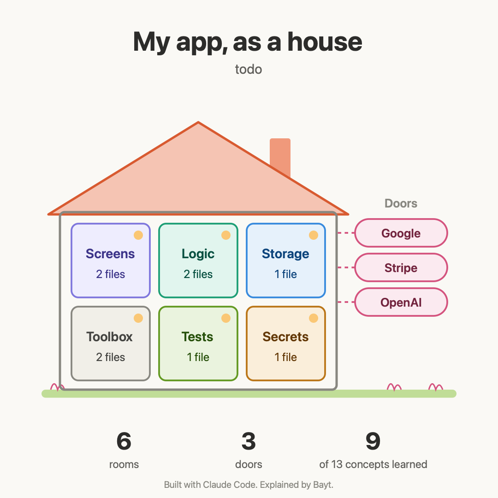

# Bayt · بيت

**Your app, as a house.** Bayt is a Claude Code mod for people who build with Claude Code but don't always know what it's doing. While Claude works, Bayt explains every step in plain words, in English or Arabic, and draws your project as a house that grows.

<p align="center"></p>

- **Plain-words cards** under every command and file change: what it does, why, and how risky it is (Safe, Careful or Danger).
- **The house**, beside the chat: rooms (Screens, Logic, Storage, Toolbox, Tests, Secrets) light up as Claude builds them. Doors appear when your app connects to Google, Stripe, GitHub and more.
- **Concepts** unlock as you meet them: Library, Database, .env, Commit, Deploy and others, each explained in one sentence.
- **Share my house**: one press makes a square picture of your app's house, ready to post.
- **English and Arabic** (friendly Shami), switched with one button.

## Install

At the prompt of a Claude Code terminal session:

```
/plugin install bayt --marketplace M-Alkassem/bayt
```

Answer `y` to add the marketplace, then pick a scope (user scope is the first one).

From a shell:

```bash
claude plugin install bayt --marketplace M-Alkassem/bayt
```

In the Claude desktop app: click **+** next to the prompt box, then **Plugins**, **Add marketplace** with `M-Alkassem/bayt`, then **Add plugin**.

## Use it

Open the pane with `/bayt`. Tap a room to see its files, tap a concept to read what it means, and press **عربي** / **English** to switch languages.

The full house drawing shows in the Claude desktop app and VS Code. In the terminal, the pane shows the same rooms, doors and concepts as text.

## Safety first

Risk levels come from fixed, tested rules, never from AI guessing. Anything Bayt doesn't recognize is marked **Careful**, never Safe. Bayt only explains: it never blocks, changes or slows down what Claude runs.

Everything stays on your computer. Bayt makes no network calls and no AI calls. Each project's house is kept in Claude Code's own plugin storage on your machine.

## Good to know

Bayt is built on Claude Code mods (function hooks), an early-access part of Claude Code whose API can change between releases.

## Develop

```bash
claude plugin validate .
claude plugin test .
```

## License

MIT
